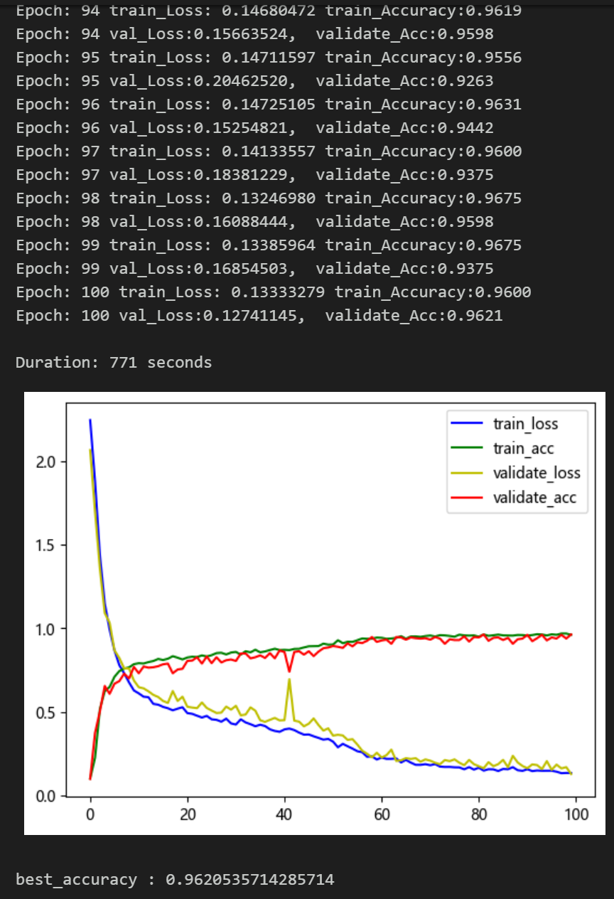
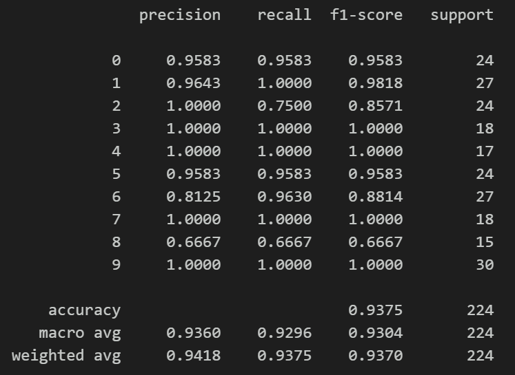

# Python-based EMD-TCN Bear Fault Classification

Includes a complete bearing fault dataset, as well as preprocessed one-dimensional fault signal datasets, classification data, and label sets that have been generated. All corresponding codes can be run.
Includes code for EMD preprocessing and EMD-TCN classification.
Environment: Python 3.9.
\n\n\n\n

## Images

<!-- PAYMENT_BLOCK -->

## Get this dataset

- Payment link (Stripe): [Buy now](https://buy.stripe.com/3cs8yP7sY87d0vu9AB)
- Payment QR code: 

<!-- /PAYMENT_BLOCK -->
